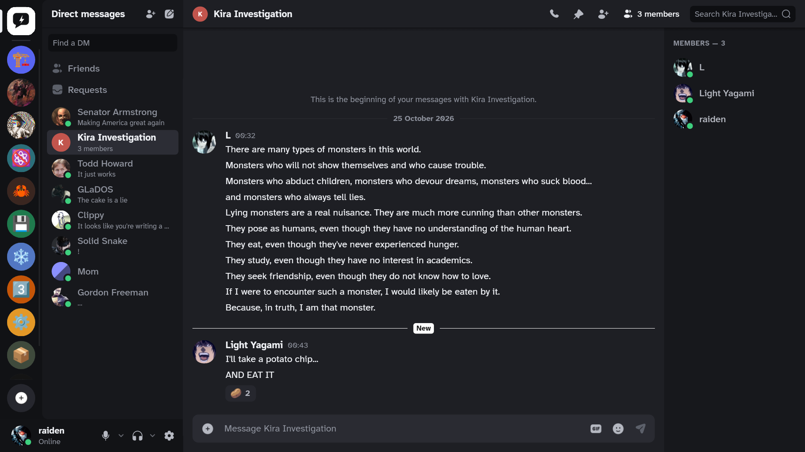
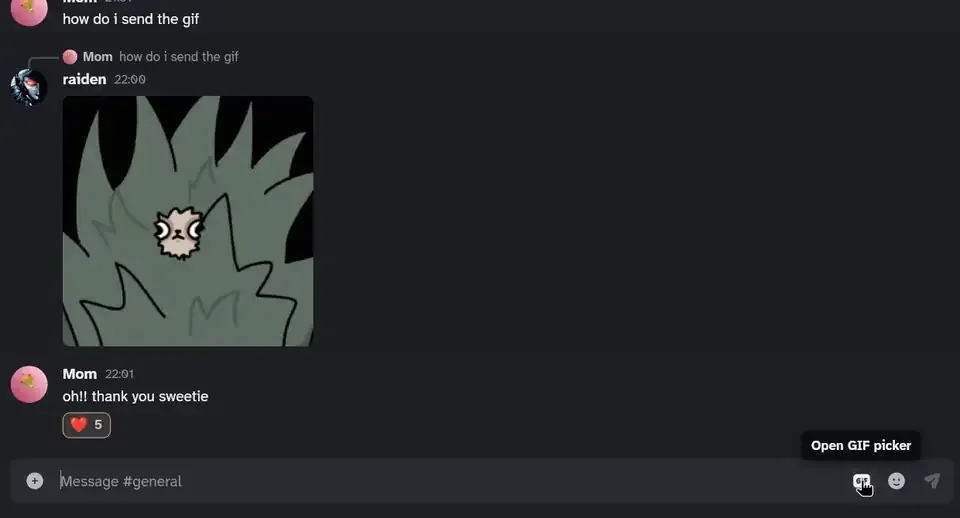
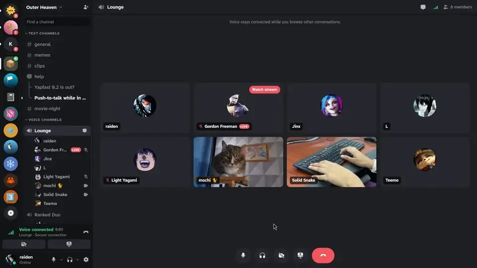
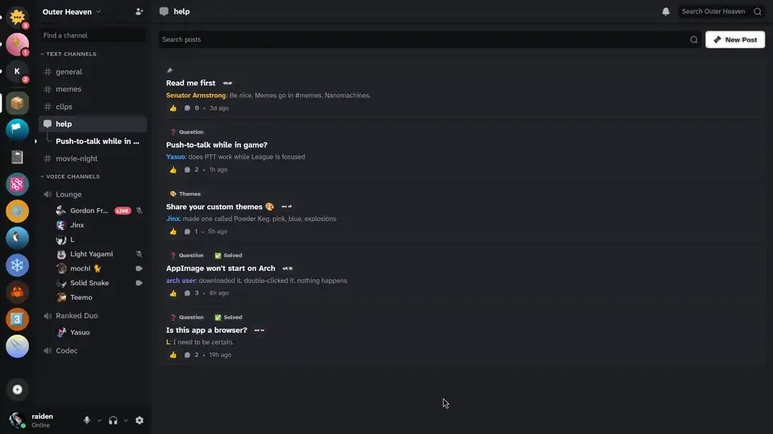
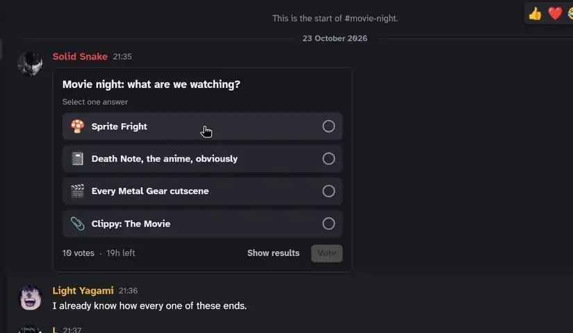
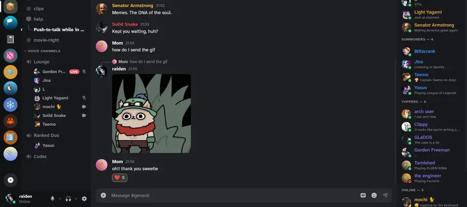
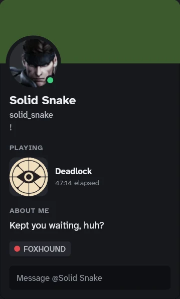
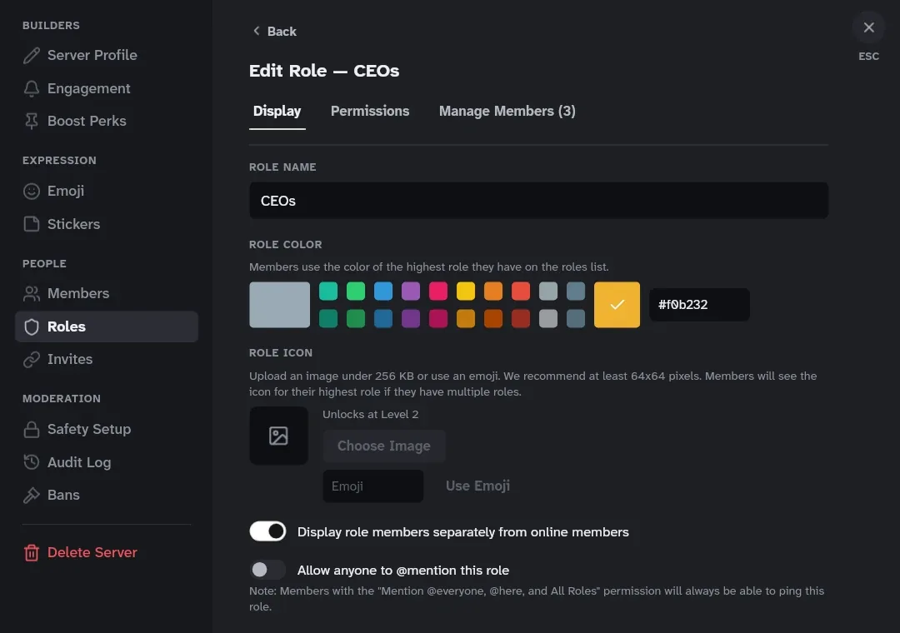

<p align="center">
  
</p>

<h1 align="center">Litecord</h1>

<p align="center">
  <strong>A native Discord client. No browser engine.</strong><br>
  About 30 MB of RAM idle, where Discord's app takes 720 MB (<a href="#measured-against-discord">measured as Vesktop</a>).
</p>

<p align="center">
  <a href="https://github.com/ganddtn40/litecord/releases/latest"></a>
  <a href="#get-started"></a>
  <a href="LICENSE"></a>
  <a href="https://github.com/ganddtn40/litecord/stargazers"></a>
</p>

<p align="center">
  <a href="#windows-10-and-11"><b>Download for Windows</b></a>
  &nbsp;·&nbsp;
  <a href="#linux"><b>Build on Linux</b></a>
  &nbsp;·&nbsp;
  <a href="https://github.com/ganddtn40/litecord">Source</a>
</p>

<p align="center">
  <br>
  <sub>A test account on a fake Discord server. Nobody in there said any of this, or endorses Litecord (sadly).</sub>
</p>

## Why?

Discord's desktop app is an entire Chromium browser running Discord's website, and it
sits at about 720 MB of RAM doing nothing. Litecord takes the opposite approach:
a native Rust app that talks to Discord directly and draws its own window with
[Slint](https://slint.dev) and Skia.

Litecord does the same job (doing nothing) in about 30 MB. There's no browser
engine anywhere in it or near it: it talks to Discord's API itself and draws its
own window with [Slint](https://slint.dev) and Skia, like a game would. Your
servers, DMs, friends, voice and GIFs are all there, and if you know Discord,
you already know where everything is.

It opens fast, too. Timed from clicking the icon to reading messages: Discord
took 8 seconds on a Windows PC; Litecord took 0.22 seconds, because it shows the
messages it saved last time and catches up while you read.

## Measured against Discord

<table>
  <tr><th></th><th>Vesktop memory</th><th>Litecord memory</th><th>Vesktop CPU</th><th>Litecord CPU</th></tr>
  <tr><td>Idle</td><td>724 MB</td><td>30 MB (−96%)</td><td>0.11%</td><td>0.015% (−86%)</td></tr>
  <tr><td>Image-heavy channel</td><td>706 MB</td><td>41 MB (−94%)</td><td>0.17%</td><td>0.008% (−95%)</td></tr>
  <tr><td>In a call</td><td>888 MB</td><td>44 MB (−95%)</td><td>0.46%</td><td>0.33% (−28%)</td></tr>
  <tr><td>Sharing your screen¹</td><td>1,013 MB</td><td>113 MB (−89%)</td><td>2.15%</td><td>1.1% (−48%)</td></tr>
  <tr><th></th><th colspan="2">Discord</th><th colspan="2">Litecord</th></tr>
  <tr><td>Opening the app²</td><td colspan="2" align="center">8 s</td><td colspan="2" align="center">0.22 s (36× faster)</td></tr>
</table>

<details>
<summary><b>About these numbers</b></summary>

<br>

Vesktop is basically Discord's own app: the same Discord web app, in the same
Electron, with Vencord on top. So its numbers stand in for Discord's. CPU counts
the whole processor as 100%.

¹ Sharing a 1920×1080 monitor at 30 frames a second, while in the call.
Litecord encodes on the graphics card when it has an encoder, here an NVIDIA
RTX 3090 sending H264. Encoding on the processor with x264 instead, it takes
2.5%, a little more than Vesktop.

² From clicking the icon to reading your messages, against Discord's own app
rather than Vesktop, timed on a Windows PC. Litecord shows the messages it saved
last time and catches up while you read.

Memory and CPU measured on 25 October 2026, and screen sharing on 27 October,
all on the same PC. The machine, what "memory" counts and how each scenario ran
are in [the measurements](docs/measurements/README.md). Your numbers will depend
on how many servers and DMs you have.

</details>

## Features

### The GIF picker

My favorite part :p Your favorites live on disk as 40 KB clips, so they're
there the moment it opens, and you're done sitting there cringing while the
GOATed GIF loads.



### Voice, cameras and Go Live

Voice channels and DM calls, with mute, deafen, a volume for each person,
noise suppression, echo removal, and a voice gate you can tune, or
push-to-talk on any key or combination, held in any app. Keybinds mute,
deafen or push to mute from any app too ([keybinds](docs/keybinds.md)). Go
Live, watch other people's streams, turn on your camera and play the
soundboard. The call stays up while you read other channels, busy voice
channels say how long their call has gone on, and pointing at a Discord
voice channel shows who is in it, who is live and whose camera is on.

The noise suppression could be better, though. Know an open source one that
does a better job? Please open an issue.



### Forums and polls

Browse a forum's posts as cards, with their tags, first message, top reaction
and thumbnail, search them, post in them, and read one beside the forum. Vote
in polls, watch the votes come in, make your own and end them early.



<p align="center">
  
</p>

### Themes

Ten of them, Catppuccin and Tokyo Night among them, and Bonfire, which is
Discord's own colors. Or make your own in the editor, and watch the window
change as you type each color.



### Games on your profile

The game you play, found among your running programs on Linux, Windows and
macOS, Steam's and Wine's included, and on Linux the Rich Presence games send,
with details, elapsed time, images and buttons.

**Settings → Game activity** turns sharing on and off as Discord's own setting
does, and names games Litecord doesn't know. See
[game detection](docs/discord/people.md#game-detection) and
[Rich Presence](docs/discord/people.md#linux-rich-presence).

What your linked Spotify account plays shows as "Listening to Spotify" with only
Litecord open, from any player, as Discord's own "Display Spotify as your status"
setting says. See [Spotify](docs/discord/people.md#listening-to-spotify).

<p align="center">
  
</p>

### Running a server

Server Settings with roles, emoji, stickers, bans, the audit log and the rest of
the pages your roles let you use, and channel settings with their permissions.
Make and edit channels and categories, invite people, hand out roles, change
nicknames, time out, kick and ban. In voice, server mute, deafen and move people
to another channel, from their menu or by dragging them there. Edit your server
profile, and leave. Join a server by invite, from the + under your servers or a
link in chat, and open a scheduled event from its link to mark yourself
interested. Folders show up as they do in Discord.

<p align="center">
  
</p>

### Everything else

- **Servers, channels, DMs and group DMs**, all live, with member lists. Pin,
  mute or close a DM from its menu, leave a group DM, and accept or ignore
  message requests.
- **Messages** you can send, reply to, edit, react to, pin, forward, mark
  unread, copy a link to and attach files to, with Markdown, embeds, custom
  emoji, stickers and spoilers. Voice messages play, with their speed and
  volume. Bots' buttons, dropdown menus and forms work too, radio buttons,
  checkboxes and file uploads included, and so do apps' slash commands: type
  `/`, pick one and fill in its options, files and autocomplete included; an
  app's answer says who used which command. Apps' message and user commands
  are under Apps in a message's or a person's menu. Discord's own links to servers, channels, messages and profiles open in
  Litecord, including one handed to it by the desktop.
- **Threads**: start one from a message, browse a channel's threads, join or
  leave one, and read it beside its channel.
- **Search** a whole server with Discord's filters, and browse a channel's pins.
- **Profiles** as Discord draws them: badges, server tags, avatar decorations,
  nameplates, name styles, profile effects and frames, and the full profile's
  Board, Wishlist and recent activity. Edit Profile changes your own theme,
  name style and server tag.
- **Friends**: requests, adding by username, nicknames, notes, profile cards,
  your status and custom status (custom emoji included). Block and ignore
  people from their menu, block and unblock them from their profile, hide what
  blocked people write, and unblock them from a list in Settings. Active Now
  sits beside the friends list.
- **Notifications** that follow your Discord settings, muting for channels,
  categories and servers, and unread markers.
- **Soft sounds** for joining, leaving, muting and messages, in six sets.

### Not there yet

- Activities.
- Making and changing server folders.
- A server's form for new members, such as its rules, when you join. Litecord
  sends you to Discord in your browser to fill it in.
- Captchas, sort of. If Discord asks for one while you link or join a server,
  Litecord opens it in your browser, but nobody has hit one against real
  Discord yet, so who knows.

Use Discord in a browser for these until then; it has all of it, and you have a
browser open anyway. [The Discord plan](docs/discord/README.md) has the rest, in
the order it's being worked on.

It's a beta, and it's used for Discord every day, so it had better be usable.
Still, there are rough edges; when you hit one,
[open an issue](https://github.com/ganddtn40/litecord/issues) and it'll get
fixed.

### Not for you?

- [Vesktop](https://vesktop.dev) if you want plugins. Litecord has none yet
  (they're coming, dw), and Vesktop ships with Vencord's.
- [Ripcord](https://cancel.fm/ripcord/) if you want something even plainer.
  It's native too, but closed source, and it does Slack on the side.

## Will Discord ban me?

> [!WARNING]
> Probably not, but it can't be promised. Third-party clients, Litecord included,
> are against Discord's Terms of Service. In practice Discord rarely bans anyone
> for using one; the accounts that get banned are almost always spamming or
> running automation. Litecord only does what you click, and keeps to the same
> limits Discord's own app does.
>
> If losing your account would be a disaster, don't use any third-party client,
> this one or another. And don't post screenshots of it in a server whose
> moderators might ban you for it. Litecord tells you all this again before it
> shows the sign-in code.

## Where your messages go

Straight from your PC to Discord, or to your Matrix server. There is no Litecord
server in between, so nothing could keep a copy (and running servers just to
snoop on DMs would be a strange business model).

- You link your account by scanning a QR code with Discord's phone app, so
  Litecord never sees your password.
- The login token stays in your system's credential store, and only ever goes
  to Discord. Unlinking signs that session out and deletes it.
- It sends no analytics or crash reports. It looks for updates only if you
  turn on **Check for updates** in **Settings → About**, with one request to
  GitHub that says nothing about you.
- Pictures and GIFs load from wherever they're hosted, such as Discord or
  Tenor.

Don't want to take that on faith? Fair, the code's all right here.

## Get started

### Windows 10 and 11

1. Download `Litecord-…-windows-x64-setup.exe` from the
   [latest release](https://github.com/ganddtn40/litecord/releases/latest).
2. Run it. It installs just for you, with no administrator prompt. The
   installer isn't signed yet, so SmartScreen may get nervous: choose **More
   info**, then **Run anyway**.
3. Litecord shows a QR code. On your phone, open Discord, go to **Settings →
   Scan QR Code**, and point the camera at it.

Rather skip the installer? The release has a portable ZIP too: extract it and
double-click `litecord.exe`.

Litecord starts with Windows and waits in the tray, so messages and calls still
reach you. Untick that in the installer, or turn it off later in **Settings →
Advanced**.

### Linux

It runs great on both X11 and Wayland, screen sharing too (Hyprland here).
This release ships the Windows build; on Linux, build it from source. The
[PKGBUILD](packaging/arch/PKGBUILD) builds the release's tag with Arch's
toolchain, and the [Nix flake](#build-it-yourself) pins everything the build
needs. The Nix route is one command, once Nix is installed:

```sh
nix profile add github:ganddtn40/litecord#litecord
```

It compiles from source, so give it a few minutes. Then link your account with
the QR code, as on Windows.

### Updates

Turn on **Check for updates** in **Settings → About**, and Litecord tells you
when a new release is out. The Windows installer's copy can then update itself
with **Update and restart**; it installs only a release signed with Litecord's
key. Update the portable ZIP the way you installed it, and Linux builds when
you rebuild them.

### macOS

Not yet. A macOS build needs an Apple machine to test on.

<details>
<summary><b>Nightly builds</b></summary>

<br>

Want what's on `main` right now, without waiting for a release or building it
yourself? Nightly builds of the Discord-only app are published on the
[releases page](https://github.com/ganddtn40/litecord/releases),
marked **Pre-release**, newest first, each with a list of what changed:

- **Windows:** the portable ZIP. Extract it and double-click `litecord.exe`.
- **Linux:** the AppImage. `chmod +x` it and run it.
- **Arch Linux:** the `.pkg.tar.zst`. Install it with `sudo pacman -U` and the
  file or its link.

They're untested between releases, so expect the odd rough edge.

</details>

## Other questions

<details>
<summary><b>What about Matrix?</b></summary>

<br>

Litecord started as a [Matrix](https://matrix.org) client, and Matrix still
works: encrypted rooms, Spaces as servers, and voice channels over MatrixRTC, in
the same window as Discord. The release is Discord-only for now, so
[build it yourself](#build-it-yourself) to get both.

After that, Telegram, Signal, WhatsApp, Instagram and Messenger are the goal.
No clue when, but hopefully at some point :p

</details>

<details>
<summary><b>Why not Tauri?</b></summary>

<br>

Tauri apps run a website too; they just borrow your system's web view instead
of shipping their own Chromium. The browser is the exact thing Litecord set out
to remove, so no.

</details>

<details>
<summary><b>Why draw on the processor?</b></summary>

<br>

It already keeps a 180 Hz monitor fed, and it takes less memory. There's a GPU
renderer too, behind **Render with the GPU** in Settings, if you'd rather use
that.

</details>

<details>
<summary><b>Can I use my Vencord plugins?</b></summary>

<br>

Nope. They need a JavaScript runtime, and Litecord's insides look nothing like
what they expect. Litecord will get plugins of its own, though, and open source
Vencord ones could be ported once it does.

</details>

<details>
<summary><b>How is it different from Serein?</b></summary>

<br>

Serein draws with wgpu, which costs more memory before you've opened a single
channel. Litecord draws with Slint, on the processor by default (WAY lighter) or
the GPU if you ask. It also does Matrix (from source, for now), DeepFilterNet
noise suppression on top of RNNoise, voice gates, and the cached GIF picker.
It's still missing a few things, like media channels and activities.

</details>

<details>
<summary><b>Did you use AI to write it?</b></summary>

<br>

Yep. Opus 5.5 wrote most of the code, and 6.1 Sol and 6 Astra did adversarial
review and helped with the nastiest bugs (networking protocols mixed with VP8 is
a bit much for a side project :D). It wasn't one prompt and done, though. The
app has been used every day for weeks, profiled with perf, read line by line,
and its UX bent to muscle memory, so switching over hurts as little as it can.

</details>

## Build it yourself

Litecord builds inside a pinned [Nix](https://nixos.org) environment, which
brings the right Rust, Clang and native libraries. From the project folder:

```sh
# Try the UI without an account
nix develop path:./nix --command cargo run --locked -- --preview

# Run it for real, with Discord and Matrix
nix develop path:./nix --command cargo run --locked

# Discord only, like the release
nix develop path:./nix --command cargo run --locked --no-default-features --features desktop,discord

# Windows installer and ZIP, cross-built from Linux, into target/dist
nix develop path:./nix#windows --command scripts/build-windows

# Format, lint and test everything
scripts/check --fast
```

### Without Nix

On Linux, `cargo run --locked` works without Nix too, with rustup, which
installs Rust 1.97.1 from `rust-toolchain.toml`, and the tools and libraries
the Arch package builds with, in `packaging/arch/PKGBUILD`. Cargo downloads
the same libwebrtc and Skia archives the Nix shell pins, except that the
Nix shell renames one libjpeg table in Skia's (`nix/prepare-skia-native.py`).
Without that, libwebrtc and Skia both define `jpeg_natural_order`, so
`build.rs` links such a build with `--allow-multiple-definition`; the two
tables are the same.

| Read this | For |
| --- | --- |
| [Contributing](CONTRIBUTING.md) | What a pull request needs: checks, memory numbers, commit style |
| [Development](docs/development.md) | Day-to-day work: the preview, local Matrix and LiveKit servers, voice tests |
| [Architecture](docs/architecture.md) | How `litecord-core` and the Slint client fit together |
| [Building](docs/building.md) | Toolchain, Cargo features, checks, releases |
| [Discord](docs/discord/README.md) | What's done, what's next, and the fake server the tests use |
| [Voice](docs/voice.md) | Calls, devices and audio processing |
| [Windows](docs/windows-beta.md) | Packaging, the installer and Windows checks |
| [Measurements](docs/measurements/README.md) | How memory and CPU are measured |

## Credits

Litecord is designed, built and maintained by
**[ganddtn40](https://github.com/ganddtn40)**.

It began as Yapfast, and the original code remains under the GNU GPL. The
Apple emoji artwork is © Apple Inc. and ships under its own licence. Every
release includes the full third-party notices. See [NOTICE](NOTICE) for the
details.

## License

Litecord is free software under the [GNU General Public License](LICENSE),
version 3 or later, © 2026
[ganddtn40](https://github.com/ganddtn40). Builds with Matrix also include
MatrixRTC libraries under the AGPL. Every release carries its dependencies'
own licenses. Take it, it's free software.

## Thanks

Litecord speaks to Discord the way its own apps do, as documented by
[Discord Userdoccers](https://docs.discord.food), a community effort to
document the user side of Discord's API. Thanks to everyone who writes it <3

It stands on [Slint](https://slint.dev), [Skia](https://skia.org),
[LiveKit](https://livekit.io) and WebRTC,
[matrix-rust-sdk](https://github.com/matrix-org/matrix-rust-sdk) and
[DeepFilterNet](https://github.com/Rikorose/DeepFilterNet). The patches to
Slint live in [`vendor/`](vendor), with the rest of the code.

<sub>Litecord isn't affiliated with or endorsed by Discord Inc. Discord is a
trademark of Discord Inc.</sub>
